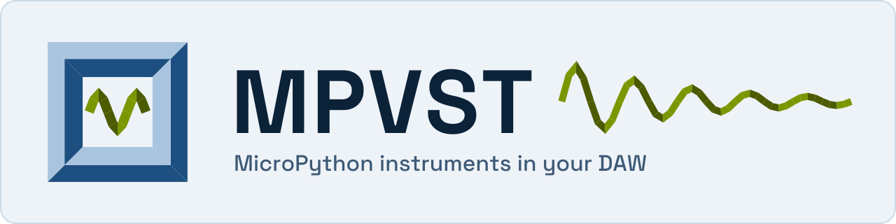

# MPVST

<picture>
  <source media="(prefers-color-scheme: dark)" srcset="docs/images/mpvst-dark.svg">
  
</picture>

MPVST is a VST3 plug-in whose instruments and effects are MicroPython-compatible
scripts: pick one from your DAW's browser, or write your own in a few lines of
Python and point the plug-in at the file.

Download the archive for your platform from the
[latest release](https://github.com/PyDevices/mpvst/releases/latest) (each has a
`.sha256` beside it), then install it:

```text
Windows   run MPVST-<version>-windows-x86_64-setup.exe
Linux     tar xzf MPVST-<version>-linux-x86_64.tar.gz, then run the install.sh inside it
```

Rescan plug-ins in your host afterwards. A real rescan, not a restart:
[Install](docs/get-started/install.md) has the details for each platform.

Save this as `pluck.py`, set `MPVST_SCRIPT_PATH` to its full path, and insert an
**MPVST Script Host** instrument in your DAW:

```python
import synthio
import vstaudio

MACRO_LABELS = ()
PATCHES = {0: ("Default", ())}
synth = synthio.Synthesizer(sample_rate=vstaudio.sample_rate(), channel_count=2)
env = synthio.Envelope(attack_time=0.005, decay_time=0.4, sustain_level=0.1, release_time=0.3)
held = {}


def on_event(kind, channel, note_id, pitch, velocity, bend, position):
    if kind == vstaudio.EVENT_NOTE_ON and velocity > 0:
        held[pitch] = synthio.Note(synthio.midi_to_hz(pitch), amplitude=velocity, envelope=env)
        synth.press(held[pitch])
    elif kind in (vstaudio.EVENT_NOTE_ON, vstaudio.EVENT_NOTE_OFF) and pitch in held:
        synth.release(held.pop(pitch))


vstaudio.on_event(on_event)
vstaudio.output(synth)
```

Play a middle C at velocity 0.8 and the script's output, rendered offline
without a DAW, measures:

```text
peak 0.40, rms 0.158 over one second
```

[First program](docs/get-started/first-program.md) shows how to reproduce that
measurement and how to hear the script in a host.

[Docs](docs/index.md) · [Examples](examples/) · [Roadmap](ROADMAP.md)

Made by [PyDevices](https://pydevices.com).
